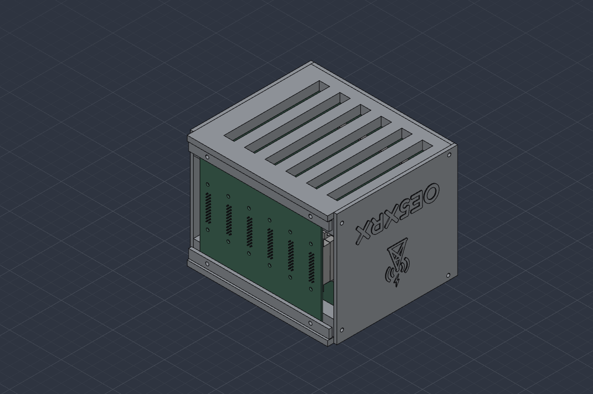
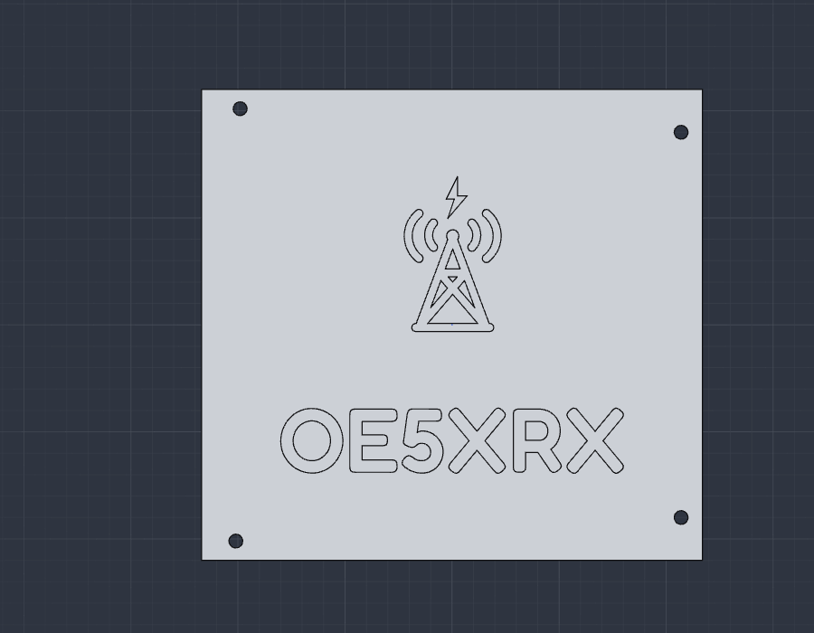
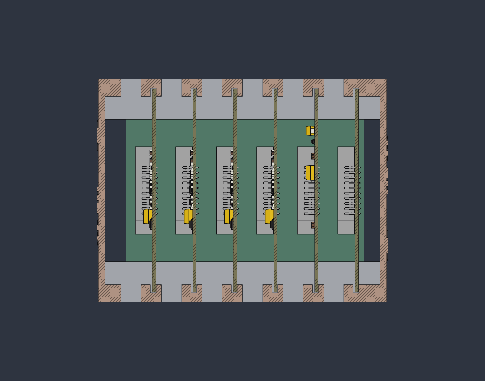

# HW-Enclosure

3D-gedrucktes Gehäuse für die OE5XRX-Remote-Station: BusBoard plus bis zu sechs 100×100-mm-Module
stecken in Kartennuten zweier Grundgestelle, seitlich schließen zwei Deckplatten ab. Das
Desktop-Gehäuse ist zum Mitnehmen, Herzeigen und für den Schreibtisch gedacht (erste Station,
DX-Camp 2025). Die ursprüngliche CAD-Quelle (Fusion 360) ist verloren; die Teile wurden aus den
Druck-G-Codes in SolidCraft parametrisch nachgebaut
(siehe [reference/reconstruction.md](reference/reconstruction.md)). Eine 19-Zoll-Variante ist geplant
(`rack-19/`).



Die Gesamtbaugruppe `desktop/station.sc` enthält alle Gehäuseteile und die echten Platinen
(KiCad-STEP) und dient der Passungsprüfung.

## Teileliste (pro Station)

| Anzahl | Teil | Datei (SolidCraft / STEP) |
|---|---|---|
| 1 | Grundgestell (normal, unten) | `desktop/parts/grundgestell.sc` / `.step` |
| 1 | Grundgestell gespiegelt (oben; so wurde es 2025 gedruckt) | `desktop/parts/grundgestell-gespiegelt.sc` / `.step` |
| 2 | Deckplatte (mit erhabenem Logo, links und rechts) | `desktop/parts/deckplatte.sc` / `.step` |
| 4 | Leiste (2 pro Gestell) | `desktop/parts/leiste.sc` / `.step` |

Das normale Grundgestell ist ein reines Spiegelbild des gespiegelten. Die beiden Deckplatten sitzen
nach der Auswertung der Bohrbilder an den Seiten (±X), nicht vorne/hinten
([reference/assembly.md](reference/assembly.md)).



Das Logo stammt aus [OE5XRX/branding](https://github.com/OE5XRX/branding); Herkunft und Aufbereitung
in [desktop/logo/SOURCE.md](desktop/logo/SOURCE.md).

## Druckeinstellungen

Aus den Original-G-Codes (Klipper-Drucker):

| Einstellung | Wert |
|---|---|
| Material | PETG |
| Düse | 0,4 mm |
| Schichthöhe | 0,2 mm (erste Schicht 0,15 mm) |
| Wände | 3 |
| Füllung | 15 %, Crosshatch |
| Deckschichten oben / unten | 4 / 3 |
| Stützen | keine |
| `xy_hole_compensation` | 0,27 mm |

Die Teile werden so gedruckt, wie sie modelliert sind; STL, 3MF und G-Code gehören nicht ins Repo
(`.gitignore`). Aus den `.step`-Dateien lassen sich STLs beliebig neu erzeugen.

## Hardware

- 6 × Einschmelzmutter M3 (Ø 5 mm × 5 mm tiefe Taschen) in der Rückseite jedes Gestells. Das ist eine
  **Interpretation** der Ø-5-Taschen, nicht gemessen. Ein Gestell hat 6 Taschen, zusammen 12 für die
  Befestigung des BusBoards. Weitere Ø-5×5-Taschen sitzen an den Seiten und vorne (je Ø 3,2 weiter);
  ob dort ebenfalls Einschmelzmuttern sitzen, ist nicht belegt.
- M3-Schrauben für BusBoard, Leisten und Deckplatten. **Längen unbekannt.** Obergrenzen aus den
  Bohrtiefen: Leisten (3 mm dick) vorne ≤ 12 mm, Deckplatten (3 mm dick) seitlich ≤ 13 mm, jeweils
  ohne Einschmelzmutter-Tasche gerechnet. Bitte am Original nachmessen.

## Status / offene Punkte

Passungsprüfung der Gesamtbaugruppe: [reference/fit-check.md](reference/fit-check.md).
Kurz: Alle 6 Platinen sitzen in den Nuten, alle 12 BusBoard-Löcher fluchten mit den Taschen, die
Stecker stecken (alle 20 Stifte je Slot in ihren Kammern). Offen:

- **Deckplatten-Loch um 1,0 mm daneben:** Das Loch (9 | 105,5) der Deckplatte liegt 1,0 mm neben der
  Gestell-Bohrung. Entweder ist die nachgebaute Position falsch (8 | 105,5) oder die echte
  Bohrung im oberen Gestell sitzt bei y = 54 (assembly.md, Frage 2).
- **Logo rechts steht auf dem Kopf:** Das Lochbild der Platte ist nicht symmetrisch; auf der +X-Seite
  muss sie um 180° gedreht werden (assembly.md, Frage 3). Eine gespiegelte Platte wäre nötig.
- **Position der hinteren Leisten unbestätigt:** Zwei Leisten sitzen sicher vorne an den Gestellen;
  die zwei anderen sind als Klemmleisten auf der Rückseite des BusBoards angenommen
  (assembly.md, Frage 4).
- **0,1 mm Stecker-Modellkonflikt:** Die Herstellermodelle von Stiftleiste und Buchse überschneiden
  sich um 0,1 mm (4,129 mm³ je Slot). Die Ursache ist offen, vermutlich Modellungenauigkeit; die
  Prüfung meldet deshalb ⚠️.

Die Deckplatten heißen in `station.sc` noch `Deckplatte-vorne`/`-hinten` (= links/rechts).

## Dateien öffnen und neu erzeugen

**Baugruppe öffnen:** `desktop/station.sc` in SolidCraft öffnen. Die Gehäuseteile sind verknüpfte
Komponenten aus `desktop/parts/`, die Platinen STEP-Komponenten aus `pcb/`. Slot 1 PowerBoard,
Slot 2 CM4Carrier, Slot 3-6 FMTransceiver (Platzhalter). Der DeviceTester liegt als STEP bereit
(`pcb/DeviceTester.step`, `pcb/DeviceTester-slot.step`), ist aber nicht bestückt.

**PCB-STEPs neu erzeugen:**

```
pcb/export-steps.sh [MODULES_DIR]   # Standard: .. (dort liegen HW-Module-*)
```

Braucht `kicad-cli` (10.x) und lokale Klone der `HW-Module-*`-Repos. Das Skript bricht ab, wenn ein
Repo uncommittete Änderungen hat oder nicht auf `origin/main` steht. Quelle (Repo + Commit) je STEP
steht in [pcb/SOURCES.md](pcb/SOURCES.md).

**Prüfungen** (SolidCraft muss laufen, gestartet mit `solidcraft --control 7878`):

```
python3 tools/check_parts.py [name ...]   # Features und Maße der Teile und Baugruppen (nur lesend)
python3 tools/fit_check.py [--no-images]  # Passungsprüfung, schreibt reference/fit-check.json
```

`fit_check.py` liefert Exit-Code 1, solange der Stecker-Modellkonflikt besteht.



## Lizenz

[CERN-OHL-S-2.0](LICENSE), wie die `HW-Module-*`-Repos.
