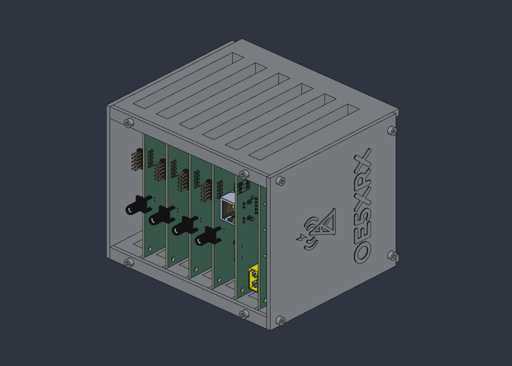
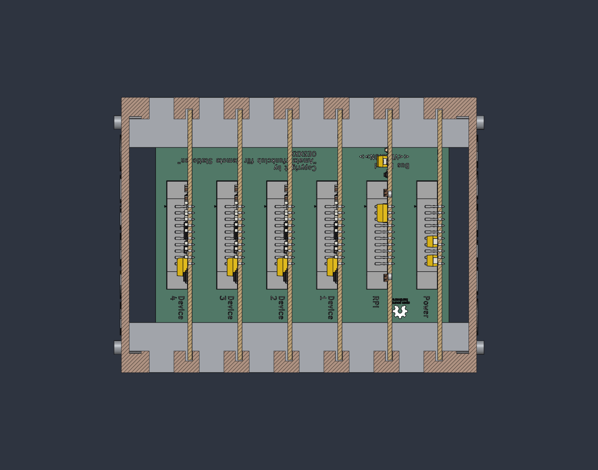
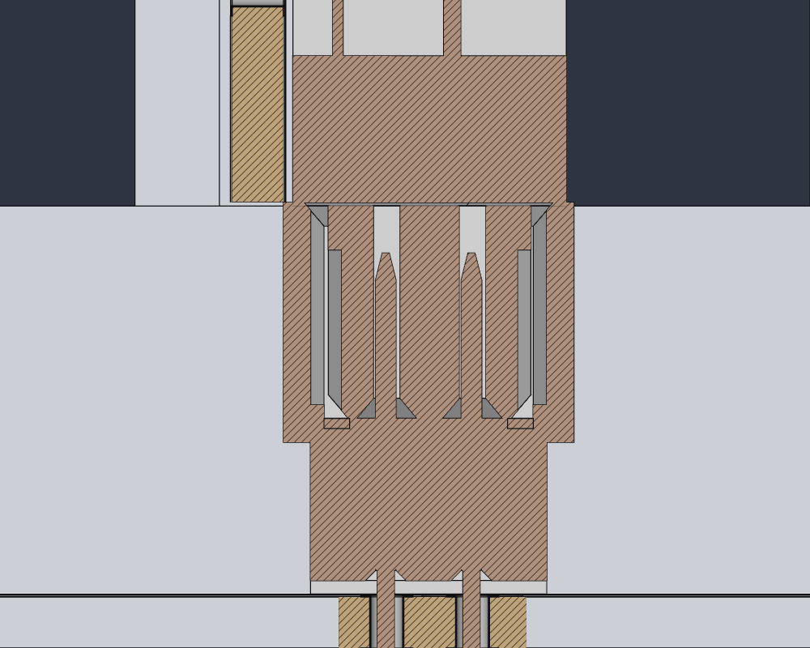
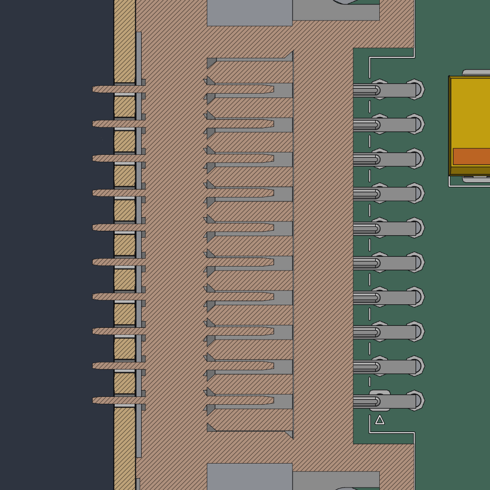
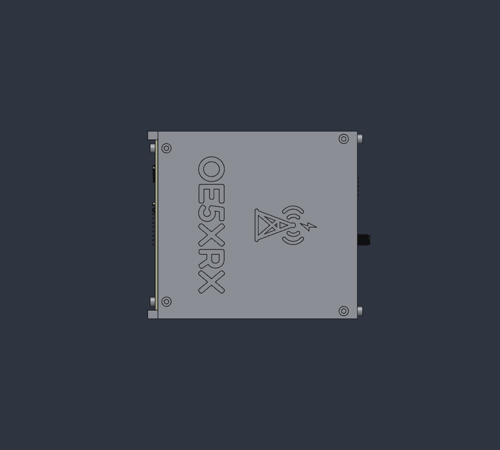
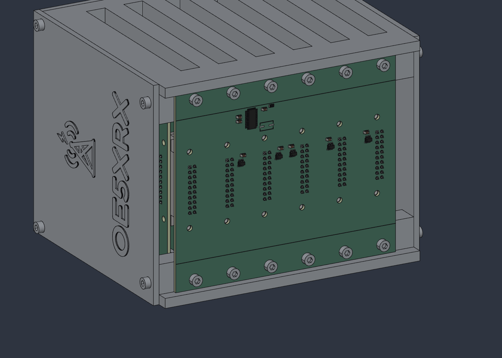
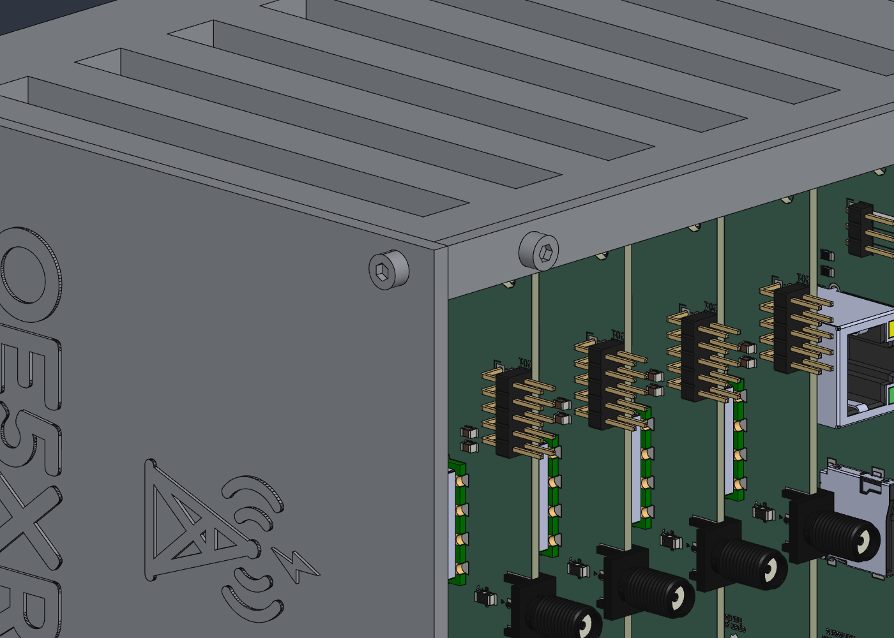

# Station fit check

## Ergebnis

| Frage | Ergebnis | Kurz |
|---|---|---|
| (a) Passen die Module in die Kartennuten? | ✅ | Alle 6 Platinen stehen in beiden Rahmen in der Nut: 0,379 mm Luft auf der Rückseite, 1,020 mm auf der Bestückungsseite (bei 1,6 mm Platinendicke), 0,5 mm über dem Nutgrund, 3,5 mm Eingriff. Kein Bauteil eines Moduls berührt Gehäuse oder Nachbarmodul. |
| (b) Stecken die Modul-Busstecker auf den BusBoard-Steckern? | ⚠️ | In allen 6 Slots sitzen alle 20 Stifte in ihren Buchsenkammern (Versatz ≤ 0,03 mm in X, ≤ 0,09 mm in Z, mindestens 0,07 mm Luft je Seite). Die Steckflächen liegen exakt aufeinander (Spalt 0,000). Aber: Die beiden Herstellermodelle haben Anschlagebenen, die 0,10 mm auseinanderliegen; dadurch überschneiden sie sich um 4,129 mm³ je Slot (Befund 1, Ursache offen). Nach der Regel (> 0,01 mm³) ist das eine Kollision, daher ⚠️ und Exit-Code 1. |
| (c) Passen die BusBoard-Löcher auf die Taschen im Rahmen? | ✅ | Alle 12 Löcher liegen achsgleich auf den 12 Taschen (Versatz 0,000 mm). |

| (d) Sitzen Schrauben und Einschmelzmuttern auf den Bohrungen? | ⚠️ | Alle 48 Teile (24 Muttern, 24 Schrauben) liegen achsgleich in ihren Taschen (Versatz 0,000 mm), die Schrauben stecken ganz in den Muttern, die Muttern füllen die Ø5×5-Taschen. Nur die zwei Plattenschrauben an dem 1,0 mm versetzten Plattenloch (9 \| 105,5) durchdringen die Platte (Befund 2). Das ist keine der drei Spec-Fragen, daher eigene Zeile. |

**Kollisionen:** 8: 6 × dieselbe Steckermodell-Überschneidung (Befund 1) und 2 × Schraube gegen Deckplatte (je 7,72 mm³, Befund 2). Sonst gibt es keine Überschneidung zwischen Platinen, Bauteilen, Gehäuse und Befestigungsteilen. 42 Paare konnten nicht gerechnet werden (Befund 6, Lötstopplack-Flächen).
**Außerhalb der drei Fragen:** Ein Deckplatten-Loch liegt bestätigt 1,000 mm daneben, an beiden Platten (Befund 2, offene Frage Q2). Q3 (Logo) und Q4 (Leisten) sind entschieden und in der Baugruppe umgesetzt (Befund 3, 4).

Diese Datei berichtet nur: Teile und Platzierungen werden hier nicht geändert. Stand: `station.sc` mit 61 Occurrences (13 Gehäuse- und Platinenteile, 48 Befestigungsteile), Platinen aus den detaillierten STEPs (alle Bauteilmodelle, Pads, Bestückungsdruck, Lötstopplack).

*Iso-Ansicht von vorne (offene Seite +Y). Links SMA (FM 1–4), Mitte RJ45 (CM4), rechts XT60 (PowerBoard). Die sichtbare Seitenplatte ist Deckplatte-links (−X, im Bild rechts); ihr Logo steht aufrecht.*

*Schnitt XZ bei y = 0, Blick von vorne nach hinten. Slot 2 (CM4) ist die zweite Platine von rechts. Jede Platine steht oben und unten in der Nut: Luft links/rechts, 0,5 mm über dem Nutgrund. Hinten liegt das BusBoard (grün) mit den 6 Steckerpaaren.*

*Schnitt XY bei z = 56,27 (Stiftpaar a6/b6 von J201) durch Slot 2, Blick von oben. Unten liegen das BusBoard und das Stiftgehäuse, darüber die Buchse mit den beiden Kammern, oben links die CM4-Platine (olivgrün). Die dünne Linie quer über die Buchse bei y = −42,5 … −42,4 ist die 0,1 mm dicke Überschneidung der beiden Modelle (Befund 1).*

*Schnitt YZ bei x = −30 (b-Reihe von J201), alle 10 b-Stifte in ihren Kammern.*

*Rechte Seite (+X). Die Schrift des Logos liegt neben dem BusBoard (links im Bild), wie auf der linken Platte; dasselbe Teil auf beiden Seiten (Q3). Je Platte vier Schrauben.*

*Blick von hinten links: die 12 Schrauben M3×6 (Ø5,5-Köpfe) sitzen auf der BusBoard-Rückseite bei z = 10 und z = 100. Keine hinteren Leisten mehr.*

*Ecke vorne rechts oben: Plattenschraube (links, M3×8 auf der Seitenplatte) und Leistenschraube (rechts, auf der vorderen Leiste).*

## Method

`tools/fit_check.py` checks the open app (`solidcraft --control 7878`) through `tools/sc_mcp.py` and only reads the design:

- `occurrence.properties` for the 61 top-level occurrences gives the world bounding box of every placed body (4725 bodies: the detailed STEPs carry ~4100 pad / silkscreen / soldermask layers besides the components; instanced STEP sub-bodies included).
- `body_topology` gives exact faces in world coordinates: planar faces with normals, and cylinders with axis and radius. It is used for the frames, plates, front strips, BusBoard PCB, one header instance and the 6 sockets.
- `inspect.clearance` (SolidCraft's interference/clearance command) runs over all 4725 placed bodies with `skip_within: "component"`, `min_volume: 0.01` and `clearance: 0.2`. In a fresh app session the run took **6416 s (107 min)** (the earlier model with 665 bodies took 453 s; the pad / silkscreen / soldermask layers dominate); 473 pairs were intersected exactly (431 of them reused from an earlier call), 9 541 486 were pruned by box/mesh. Do not narrow the run with `bodies`/`against`: bodies of several instances share one name (e.g. the 6 BusBoard headers) and only one instance is matched. Pairs inside one top-level occurrence (a part on its own PCB) are dropped. 42 pairs are reported as unchecked (Befund 6).
- `inspect.section` plus `screenshot {source: "model", camera}` give the pictures. The section is cleared again at the end.

No scratch design was needed, because SolidCraft has a direct interference command. `station.sc` is only read (`dirty: false` before and after the run).

Re-run: `python3 tools/fit_check.py` (add `--no-images` to skip the pictures). It writes `reference/fit-check.json`. Exit 0 = all checks "pass", 1 = any check is "warn" or "fail" (currently 1, because B and D are "warn"), 2 = the app cannot be used (e.g. another design with unsaved changes is open).

Pass criteria: groove clearance > 0 on both sides, floor gap ≥ 0, engagement > 0. Connector: 20/20 pins inside a cavity, side gap > 0, pin-to-cavity centre offset ≤ 0.15, mating-face gap and axial interference ≤ 0.2. Holes: axis offset ≤ 0.1. Fasteners (D): axis offset to the pocket and to the plate / strip / BusBoard hole ≤ 0.1, no overlap with any other part. A collision is an overlap > 0.01 mm³.

## (a) Board edge in the grooves

Groove walls and floors come from the frame faces (`body_topology`). Board extents come from the PCB body of each module.

| module | board x (underside … component plane) | groove walls x | clearance −X / +X | board centre − groove centre | floor gap bottom / top | engagement bottom / top | board y in groove y |
|---|---|---|---|---|---|---|---|
| Slot1 PowerBoard | −57.121 … −55.520 | −57.5 / −54.5 | 0.379 / 1.020 | −0.321 | 0.5 / 0.5 | 3.5 / 3.5 | −42.374…57.626 in −42.5…60 |
| Slot2 CM4Carrier | −37.121 … −35.520 | −37.5 / −34.5 | 0.379 / 1.020 | −0.321 | 0.5 / 0.5 | 3.5 / 3.5 | same |
| Slot3 FM | −17.121 … −15.520 | −17.5 / −14.5 | 0.379 / 1.020 | −0.321 | 0.5 / 0.5 | 3.5 / 3.5 | same |
| Slot4 FM | 2.879 … 4.480 | 2.5 / 5.5 | 0.379 / 1.020 | −0.321 | 0.5 / 0.5 | 3.5 / 3.5 | same |
| Slot5 FM | 22.879 … 24.480 | 22.5 / 25.5 | 0.379 / 1.020 | −0.321 | 0.5 / 0.5 | 3.5 / 3.5 | same |
| Slot6 FM | 42.879 … 44.480 | 42.5 / 45.5 | 0.379 / 1.020 | −0.321 | 0.5 / 0.5 | 3.5 / 3.5 | same |

The top frame gives the same numbers as the bottom frame (floor z 105.5 vs board top 105.0).

This confirms assembly.md:
- Board thickness is taken as 1.6012 (underside to the component plane where every STEP component sits). The exported KiCad board *body* is only 1.516 thick (core without copper/mask), so measuring to the body face would give 1.105 / −0.363: that is a model artefact, not real clearance. The verdict values above (1.020, centre −0.321) match assembly.md's prediction (0.379 / 1.020, −0.318 for a 1.606 stack) to 0.003. The script records both (`clear_high`, `clear_high_body`).
- The back edge is 0.126 in front of the back wall's front face (y −42.5), in both frames. This is the closest the modules come to the enclosure.
- No module component overlaps, touches or comes within 0.2 mm of a frame, plate, strip or neighbouring module.

## (b) Connector mating

Per slot: header instance (on the BusBoard) vs the module's socket (`PCN10C-20S-2.54DS`). Pin side faces (0.6 × 0.6 pins) come from the header topology, translated to each instance. Cavity walls (0.8 × 1.1) come from each socket's own topology.

| slot | header b row x | pins in cavity | max \|dx\| | max \|dz\| | min side gap | socket face y / header housing top y | mating gap | header top y / socket stop y | axial interference | overlap |
|---|---|---|---|---|---|---|---|---|---|---|
| 1 PowerBoard (J301) | −50 | 20/20 | 0.030 | 0.090 | 0.070 | −48.8 / −48.8 | 0.000 | −42.4 / −42.5 | 0.100 | 4.129 mm³ |
| 2 CM4Carrier (J201) | −30 | 20/20 | 0.030 | 0.090 | 0.070 | −48.8 / −48.8 | 0.000 | −42.4 / −42.5 | 0.100 | 4.129 mm³ |
| 3 FM 1 (J401) | −10 | 20/20 | 0.030 | 0.090 | 0.070 | −48.8 / −48.8 | 0.000 | −42.4 / −42.5 | 0.100 | 4.129 mm³ |
| 4 FM 2 (J501) | +10 | 20/20 | 0.030 | 0.090 | 0.070 | −48.8 / −48.8 | 0.000 | −42.4 / −42.5 | 0.100 | 4.129 mm³ |
| 5 FM 3 (J601) | +30 | 20/20 | 0.030 | 0.090 | 0.070 | −48.8 / −48.8 | 0.000 | −42.4 / −42.5 | 0.100 | 4.129 mm³ |
| 6 FM 4 (J701) | +50 | 20/20 | 0.030 | 0.090 | 0.070 | −48.8 / −48.8 | 0.000 | −42.4 / −42.5 | 0.100 | 4.129 mm³ |

Pin positions are taken from the 3D models. The header pins sit at x −12.57/−10.03 for J401, i.e. 0.03 from the footprint rows −12.54/−10.00 (BusBoard holes, exact). In z they sit 0.02 above the footprint. The socket cavities sit exactly on the rows in x and 0.07 below the footprint in z. The 0.09 z offset therefore comes from two vendor-model offsets, not from the placement. The THT holes of the module sockets (PCB body) are at the header pin heights z 43.57 … 66.43, to 0.000.

## (c) BusBoard holes vs back pockets

Axes of the 12 Ø3.2 BusBoard holes (`BusBoard_PCB`) against the 12 Ø5 pocket axes in the back faces y = −54 of both frames:

| holes | x | z | offset |
|---|---|---|---|
| H101–H106 → bottom pockets | −50, −30, −10, 10, 30, 50 | 10 | 0.000 (all 6) |
| H109, H110, H111, H112, H107, H108 → top pockets | −50, −30, −10, 10, 30, 50 | 100 | 0.000 (all 6) |

The board edges rest on both 5 mm steps: contact at z 5 (bottom frame) and z 105 (top frame). The header housings sit at y −54.000 (housing top −48.8 = −54.000 + 5.2), i.e. the BusBoard's component side lies exactly on the back faces y −54. The `BusBoard_PCB` body face at y −54.085 is the same thin-body artefact as on the modules (Befund 5).

## Other hole patterns (not part of the three questions)

| occurrence | holes vs target | offsets |
|---|---|---|
| Deckplatte-links | 4 holes vs side bores (Ø3.2, x −63) | 0.000, **1.000** (y 54 vs 55, z 105.5), 0.000, 0.000 |
| Deckplatte-rechts | 4 holes vs side bores (x +63) | 0.000, **1.000** (y 54 vs 55, z 4.5), 0.000, 0.000 |
| Leiste-1 / Leiste-2 | 2 holes each vs front bores (y 55, x ±50) | 0.000 |

## (d) Schrauben und Einschmelzmuttern

Achse jedes Teils (Mitte seiner Bounding Box quer zur Schraubenrichtung) gegen die Ø5-Tasche im Gestell und gegen das Loch des durchsteckten Teils:

| Gruppe | Anzahl | Versatz zur Tasche | Versatz zum Loch in Platte / Leiste / BusBoard |
|---|---|---|---|
| Mutter-Platte | 8 | 0.000 | – |
| Schraube-Platte (M3×8) | 8 | 0.000 | 0.000 (6×), **1.000** (`Schraube-Platte-L3`, `-R1`) |
| Mutter-Leiste | 4 | 0.000 | – |
| Schraube-Leiste (M3×8) | 4 | 0.000 | 0.000 |
| Mutter-Bus | 12 | 0.000 | – |
| Schraube-Bus (M3×6) | 12 | 0.000 | 0.000 (BusBoard-Löcher) |

Kontakte der Befestigungsteile (82 Paare mit Abstand 0): jede Schraube in ihrer Mutter (24, Zylinderfläche Ø3), jede Mutter in der Tasche des Gestells (24); Deckplatte und Leiste liegen auf der Mutter-Stirnseite (8 + 4); die Köpfe der 6 störungsfreien Plattenschrauben und der 4 Leistenschrauben liegen auf Platte beziehungsweise Leiste auf (6 + 4), die Köpfe der Bus-Schrauben auf der BusBoard-Rückseite (12, `BusBoard_PCB`). Die Schäfte haben 0,1 mm Luft in den Gestellbohrungen (Ø3 in Ø3.2, 12 Paare). Die Muttern der BusBoard-Befestigung sind 0,035 mm (Lötstopplack) beziehungsweise 0,085 mm (`BusBoard_PCB`-Körper) von der Platinenvorderseite entfernt: das ist der 1,516/1,6012-Modellartefakt (Befund 5), keine Lücke.

## Interference summary

- **Collisions (overlap > 0.01 mm³): 8.** 6 × a module socket against its BusBoard header, 4.129 mm³, in the slab y −42.5 … −42.4, x ±4.05 around the connector, z 38.97 … 71.07 (Befund 1). 2 × a plate screw against the cover plate at the 1.0 mm off hole, 7.723 mm³ each (`Schraube-Platte-L3` against `Deckplatte-links`, `Schraube-Platte-R1` against `Deckplatte-rechts`; Befund 2).
- **Touching (distance 0), 15 pairs without fasteners, all intended contacts:** both frames with both plates, both frames with the front strip of their frame, both plates with both front strips, the BusBoard edges on the bottom step (z 5) and top step (z 105). Dazu 82 Paare mit Befestigungsteilen (Abschnitt (d)).
- **Near (0 < d < 0.2 mm): 33 pairs without fasteners:** each module PCB back edge is 0.026 from its header's top corner, each module PCB is 0.126 from the back walls of both frames, and the frames are 0.010 from the BusBoard's soldermask sheet. Dazu 36 Paare mit Befestigungsteilen (Abschnitt (d)).
- PCB vs PCB: none. The only contact between boards is the connector pair.
- Unchecked pairs: 42 (Befund 6).

## Findings

1. **Connector models overlap 0.10 mm axially (all 6 slots, 4.129 mm³ each).** The socket's mating face lies exactly on the header housing (y −48.8; this is how assembly.md placed it). Behind that, the header model has a second seating plane at y −42.4 (11.6 above the BusBoard component plane) and the socket model one at y −42.5: two seating planes 0.10 mm apart. The overlap is 4.129 mm³ / 0.1 mm = 41.3 mm² over a bbox of 8.1 × 32.1 mm, i.e. housing-sized, not the pin tips (20 pins × 0.36 mm² = 7.2 mm² at most). The cause is unresolved: no datasheet mated height was checked. In reality one of two things happens. Either the header bottoms out in the socket 0.10 mm before the faces touch, so the module sits 0.10 mm further forward: back-wall clearance goes from 0.126 to 0.226 and the front edge to 57.726 (frame front 60). Or the two vendor models are not exact about the mated height. Neither case is a fit problem: the board stays in the grooves (3.5 mm engagement along z is unaffected) and the pins are inside the cavities. → ⚠️ instead of ✅ for (b).
2. **Cover plate hole 1.000 off (Q2, confirmed on both plates); screw collides there.** Hole B of the plate (local (9 | 105.5)) lands at y 54.0 while the bores are at y 55.0. It is at the top front corner on the left plate and the bottom front corner on the right plate. The Ø3.2 hole and the Ø3.2 bore overlap only in a 2.2 mm wide passage, so an M3 screw (3.0) will not go through without opening up the hole. In the assembly the screws sit on the frame bores as instructed, so `Schraube-Platte-L3` (left, z 105.5) and `Schraube-Platte-R1` (right, z 4.5) cut into the plate: 7.72 mm³ each at (±69.5, 55.77, z). Either the plate hole should be (8 | 105.5), or the frame bore is at y 54. No part was changed.
3. **Logo (Q3, entschieden).** Peter: Die Station steht im Betrieb auf dem BusBoard; das Logo ist um 90° gedreht, die Schrift liegt neben dem BusBoard, dasselbe Teil auf beiden Seiten (siehe Seitenbild). Die um 1,0 mm versetzte Bohrung B liegt weiter an der Platte links oben und rechts unten, die rechte Platte ist also dasselbe Teil um 180° um die Normale gedreht.
4. **Leisten (Q4, entschieden): nur vorne.** Die hinteren Klemmleisten `Leiste-3`/`-4` sind entfernt. Die Bohrungen der Vorderleisten fluchten mit den Frontbohrungen (0.000). Die BusBoard-Schrauben M3×6 sitzen mit dem Kopf direkt auf der Platinenrückseite; ihre Köpfe (Ø5,5 × 3 bei z 10 / 100) liegen frei von Bauteilen (die Rückseitenbauteile liegen bei z 64…90).
5. **Board body thickness is a model artefact, not a gap.** The KiCad STEP export makes every board body ~1.516 thick (core without copper/mask), while all components sit on the 1.6012 component plane. On the BusBoard the header bases are exactly at y −54.000 (on the back faces), so the real board lies flat on the frame; the 0.085 between `BusBoard_PCB` (y −54.085) and y −54 does not exist on the real part and nothing shifts when screwed. On the modules the same artefact would inflate the +X groove clearance to 1.105; the real value is 1.020 (table (a)).

6. **Lötstopplack-Flächen sind keine Volumenkörper, 42 Paare ungeprüft.** Die STEP-Export-Lötstopplack-Körper (`*_soldermask`) sind nulldicke Flächen (z. B. `BusBoard_soldermask (2)` bei y −55.6512, 0.05 hinter der Platinenrückseite −55.6012); `inspect.clearance` meldet für sie `boolean Intersect: the operation failed`. Betroffen: 24 × Bus-Schraube gegen die zwei BusBoard-Lackflächen (der Schraubenkopf liegt auf y −55.6012, die Rückseiten-Lackfläche schneidet 0.05 hinein, entspricht der echten Lackdicke), und 18 Paare Lackflächen gegen Gestelle und Header. Keines davon ist ein Passungsproblem; es gibt keinen Anlass für eine Überschneidung, sie sind nur nicht gerechnet.

No part or placement was changed. Raw numbers: `reference/fit-check.json`.
